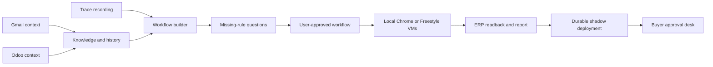

# Hackathon submission guide

[Watch the demo](https://youtu.be/JZss4Wk5brI) · [Repository](https://github.com/SomeshAgrawal1318/YC-Hackathon-MCL)

MonteCarlo Labs turns an observed purchasing chore into a workflow: combine a recording with company context, ask for missing rules, test the workflow, then compare shadow drafts with the buyer's actual orders.

## Follow one use case

A supplier email confirms a purchase order. The buyer copies the reference, product, quantity, price and delivery date into Odoo. Trace captures that work. The workflow builder combines the recording with order history and company rules; the user resolves unanswered questions before approving the workflow. Six variations exercise ordinary orders, missing information and price changes. Live runs read back Odoo's saved records. A price increase above the configured threshold pauses for a buyer decision.

## What is implemented

| Capability | Implementation and boundary |
| --- | --- |
| Observe work | Windows Rust UI Automation helper plus screen recording. Browser-only demo uses fixtures. |
| Gather context | Gmail, Odoo and recording knowledge extraction; workflow inference from recording, rules and order history. Claude-backed extraction requires a key. |
| Ask questions | In-app workflow questions and buyer approval desk. Teams/Slack outreach is not implemented. |
| Test | Local Chrome automation or isolated Freestyle VMs with their own Odoo. Presenter simulation is explicitly separate from real execution. |
| Durable execution | Terse Durable Actors hold shadow deployment and buyer approval state. Dev-runtime alarms are re-armed on connection. |
| Agent Relay | Not integrated. Do not claim this sponsor requirement is met. |
| General enterprise integrations | Gmail/Odoo is the concrete implementation. Automatic connector generation for arbitrary ERP/WMS/CRM/EHR systems is future work. |
| Production rollout | Shadow comparison and explicit buyer decisions exist. This is a hackathon prototype, not an unrestricted autonomous production deployment. |

## Architecture

Start with `src/lib/workflowBuilder.ts` for inference, `src/lib/runner.ts` for execution, `electron/hands.cjs` for browser actions, and `actors/src/actors.ts` for persistent shadow/approval state.

## Contributions adapted from Arcada

- Rakazo's bounded retry policy: known read operations can recover from temporary failures; writes and unknown methods never automatically retry. Every RPC has a timeout, rejects redirects and validates its response ID. [License and source provenance](../third_party/README.md).
- Exact-origin checks inspired by Arcada's contracts and destination validation: Gmail lookalikes are rejected, Odoo credentials stay on the configured origin, and cached ERP tabs are checked at operation boundaries. The VM browser's internal origin is distinct from the host RPC address. These checks are not full browser network isolation.
- One local/CI verification command: `npm run check` runs typechecking, workflow tests, Electron boundary tests and the production build.

## Submission verification (2026-10-31)

- `npm run check`: typecheck, 60 workflow tests, 9 Electron boundary tests and production build passed.
- `npm audit`: zero known vulnerabilities in the root app dependency tree after updating Electron, Vitest and Nodemailer. `vite-node` is now a direct dependency so the setup scripts do not rely on Vitest's transitive dependencies.
- Browser walkthrough exercised the actual UI from loading a demo recording through workflow approval and all six simulated results: four saved, one asked a buyer, one flagged. No uncaught page errors.
- Electron 45.2.1 launched the built app on macOS and rendered the Recordings screen. This does not verify Windows capture or external integrations.

## Verification before presenting

1. Run `npm ci`, `npm run check`, and `npm audit`. CI covers the app and mocked Electron boundaries; it does not prove live credentials or external services work.
2. Exercise the no-key browser path in the root README. Fixture/simulated results must be described as such.
3. On Windows, follow the live setup below the quickstart in the README. Record a fresh Gmail-to-Odoo chore and confirm the video/timeline contains the actual input.
4. Run all six live scenarios and inspect the saved Odoo records against the report. Verify a price-change case pauses and the buyer can approve or reject it.
5. With Freestyle credentials configured, check VM creation, live view, independent ERP state and cleanup. VM use incurs provider charges.
6. Restart Durable Actors and verify the shadow state and pending approvals remain. No live Windows, VM or actor restart proof is supplied by the unit tests.

Keep credentials in `.env.local`. Use dedicated demo accounts and synthetic business data. Never commit inbox exports, recordings containing company data, provider keys or VM access tokens.
